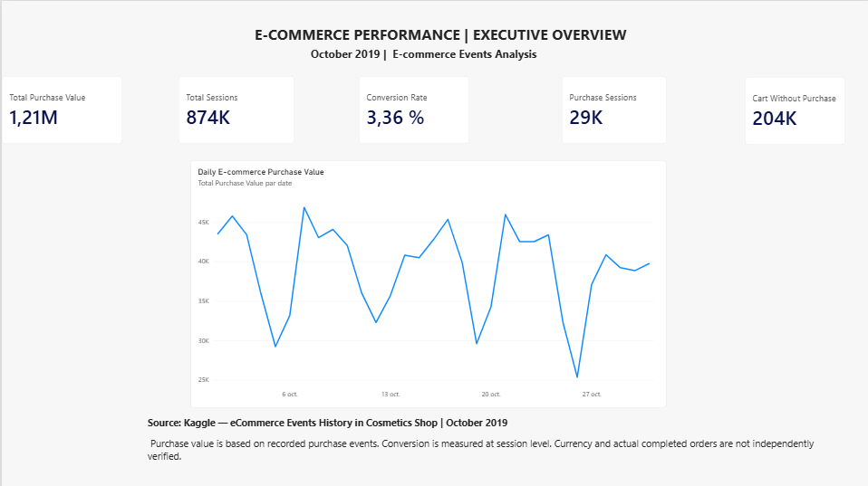
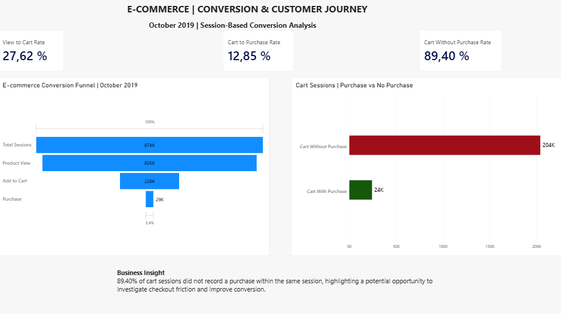
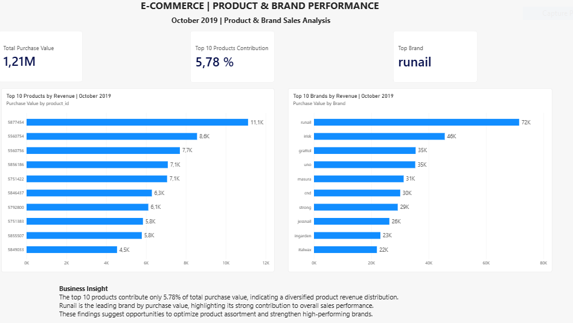

# E-commerce Performance & Conversion Analysis

## Project Overview
End-to-end Business Intelligence project analyzing e-commerce activity from October 2019 using Python, Pandas, Power BI and DAX.

The objective is to understand purchase activity, customer conversion, shopping cart behavior, and product and brand performance.

## Technologies
- Python, Pandas
- Jupyter Notebook (VS Code)
- Power BI Desktop
- DAX
- Data Cleaning, Exploratory Data Analysis (EDA), Data Visualization

## Key Performance Indicators

| KPI | Result |
|---|---|
| Total Purchase Value | 1,211,538.43 (dataset units) |
| Total Sessions | 873,960 |
| Conversion Rate | 3.36% |
| Purchase Sessions | 29,326 |
| View to Cart Rate | 27.62% |
| Purchase Sessions / Cart Sessions | 12.85% |
| Cart Without Purchase Rate | 89.40% |
| Top 10 Products Contribution | 5.78% |
| Leading Identified Brand | runail |

## Power BI Dashboard

### 1. Executive Overview

### 2. Conversion & Customer Journey

### 3. Product & Brand Performance

## Key Business Insights
- 3.36% of observed sessions included a purchase.
- 89.40% of cart sessions did not record a purchase within the same session.
- The top 10 products contributed 5.78% of recorded purchase value.
- Runail was the leading identified brand by recorded purchase value.

## Project Structure
- `notebooks/`: Python data exploration and analysis
- `data/`: Prepared CSV tables for reporting
- `powerbi/`: Interactive Power BI dashboard (.pbix)
- `screenshots/`: Dashboard screenshots
- `reports/`: Final analytical PDF report

## Methodology
1. Explore and prepare event-level e-commerce data with Python and Pandas.
2. Aggregate purchase value, sessions, product and brand performance.
3. Calculate session-level conversion and cart behavior metrics.
4. Build an interactive three-page Power BI dashboard using DAX.
5. Interpret results and propose business recommendations.

## Data Source
Kaggle — eCommerce Events History in Cosmetics Shop (October 2019).

The original dataset and large cleaned sample are not included in this repository. Some notebook cells may require the original data files to reproduce the analysis.

## Notes and Limitations
Purchase value represents recorded purchase events, not independently verified completed orders. Currency is not independently verified. The 12.85% purchase-sessions-to-cart-sessions KPI is an overall ratio, not the within-cart purchase conversion rate.

## Author
Lamia Bendou
  
